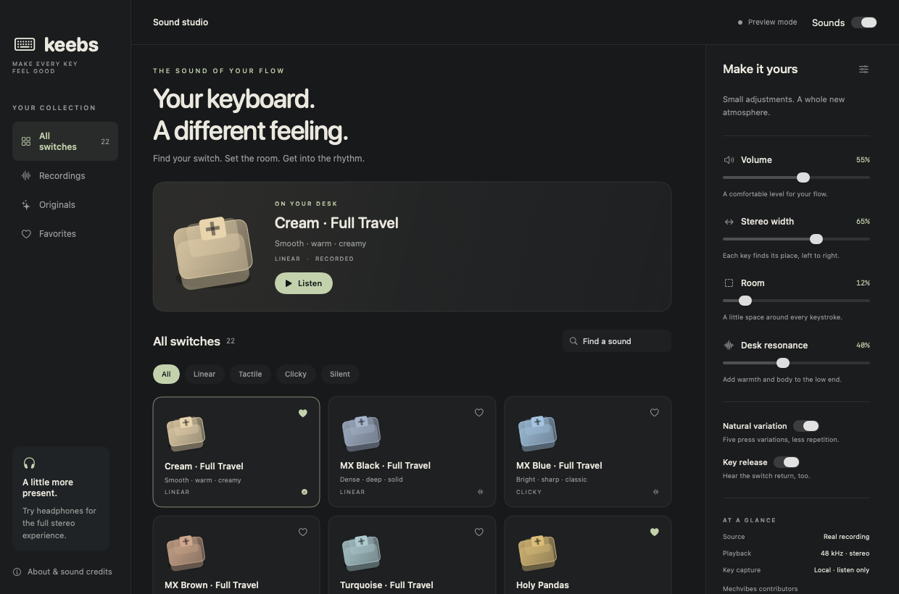
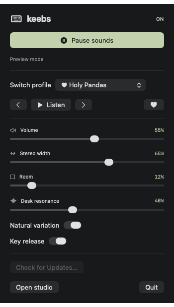
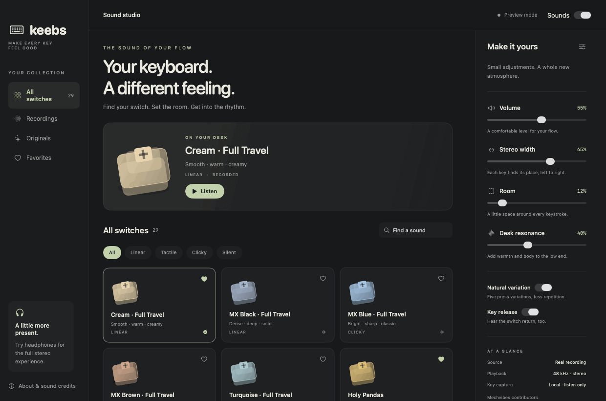

<p align="center">
  
</p>

# Keebs

A native macOS mechanical keyboard sound studio: a full SwiftUI desktop app with a menu bar shortcut, 29 sound profiles, and a little more presence in every keystroke.

Requires **macOS 14 or later**. Uses Apple's frameworks and Sparkle 2.10.0 for signed in-app updates.

## Screenshots

### Sound studio

Browse switch profiles and adjust volume, stereo width, room, and desk resonance.

[](docs/images/studio.png)

### Menu bar controls

Pause sounds, switch profiles, or adjust your mix from the menu bar. Keebs runs in the background without a Dock icon.

<p align="center">
  <a href="docs/images/menu-bar.png">
    
  </a>
</p>

## Preview

Explore 29 profiles in the desktop studio, or adjust your sound directly from the menu bar.



*Rendered from the app's native views with demonstration settings. [How to refresh the visuals](docs/VISUALS.md).*

## Run on your Mac

Install Xcode 15+ or Apple's Command Line Tools, then:

```sh
git clone https://github.com/samidun26/keebs.git
cd keebs
swift test
bash scripts/build-app.sh
open dist/Keebs.app
```

For both Apple Silicon and Intel, use `KEEBS_UNIVERSAL=1 bash scripts/build-app.sh`. Open `Package.swift` in Xcode to edit and debug. Use the packaged app for permission and login-item checks; Swift Package previews and an unbundled executable do not provide the same app identity.

Keebs starts in the **menu bar**, with no Dock icon or studio window. Click its keyboard icon and choose **Open studio** when you want the full library. Closing the studio keeps keyboard sounds running; use **Quit** in the menu bar panel to stop Keebs. If an older version was pinned to the Dock, remove that pinned shortcut separately.

Click **Enable** and allow Keebs under **System Settings → Privacy & Security → Input Monitoring**. If macOS requests it, quit and reopen the app. Preview buttons and the focused keyboard test area also work without system-wide permission. Move the app into `/Applications` before enabling launch at login, and keep it in a stable location when testing permissions.

## The experience

- Thirteen recorded sets: Cream Full Travel, MX Black, MX Blue, MX Brown, Turquoise, Holy Pandas, **Alpaca, Gateron Black Ink, Gateron Red Ink, Kailh Box Navy, SKCM Blue Alps, Topre, and Buckling Spring**. Five generic press slots per set and separate release recordings. Dedicated Space, Return, and Delete recordings where available; MX Blue uses its generic samples for those keys. Some source variation slots share a clip.
- Sixteen original synthesized profiles across linear, tactile, clicky, and silent categories, explicitly labeled as synthesis rather than recordings of a commercial switch.
- Physical key positions control stereo panning. Space, Return, and Delete have their own sound character. Repeated OS keydown events are ignored.
- Preloaded 48 kHz samples, 32 overlapping voices, room reverb, low-frequency desk resonance, and a peak limiter. Volume, stereo width, natural variation, and key releases are adjustable.
- Search, category filters, favorites, an interactive keyboard playground, persistent settings, and optional launch at login. Click the **keyboard icon in the macOS menu bar** to pause/resume, choose or cycle switches, preview/favorite a sound, and adjust volume, stereo width, room, and desk resonance directly. Desktop and menu bar controls share the same settings. **⌘⇧M** toggles sound while Keebs is the active app.
- Listen-only key capture. No typed characters are read, no keystroke history is saved, and macOS secure input pauses capture. Sleep, wake, and audio-device changes reset or reload playback.

The app makes network requests to GitHub only for update checks and downloads; it sends no analytics or system profile. Automatic update checks are optional. Settings and favorites live in macOS UserDefaults. Stereo positions use an ANSI layout approximation; unknown key codes are centered. Modifier-only presses currently do not play sounds.

## Recordings and licenses

Bundled recordings come from [Mechvibes](https://github.com/hainguyents13/mechvibes) at pinned commit `326252a13e7bef4f1c35d08ef0189b5af6f8ba02`, and [kbsim](https://github.com/tplai/kbsim) at `ba103f3b0afa9dab80447aa2e7e2ed80b6bd80e4`, under their MIT licenses. Holy Pandas also retains its pack-specific MIT notice. kbsim recordings are credited to Thomas Lai. Original files are preserved; Keebs decodes, converts to mono, resamples, and applies short boundary fades at load time.

See [third-party notices](docs/THIRD_PARTY_NOTICES.md), [Mechvibes provenance](docs/audio-provenance.json), and [kbsim provenance](docs/kbsim-audio-provenance.json) for attribution and original Git blob hashes. [The recording library](docs/RECORDINGS.md) explains the new sets and their source limitations. Keebs is independent of Klack and switch manufacturers; it uses no Klack code, artwork, or audio.

## Validation and distribution

Version 0.1.4 starts as a menu bar app with no Dock icon. The studio opens on demand, and closing it keeps the sound service running. Automated lifecycle checks verify accessory activation, background launch, and studio close/reopen without interrupting audio.

Version 0.1.3 expands the library to 13 recorded sets and 16 original synthesized profiles. All recordings are tested for Apple audio decoding and playback through the app’s real audio graph.

Version 0.1.2 adds **Check for Updates…** in the app menu, menu bar panel, and studio, plus optional automatic checks. Sparkle verifies update signatures, installs, and relaunches after confirmation. The release workflow signs archives and publishes the update feed. See [one-time setup and release instructions](docs/UPDATES.md); GitHub needs the private signing-key secret before the first release can be published.

GitHub Actions runs the Swift tests on macOS, builds a universal `.app`, validates the resource bundle and signature, and uploads `Keebs-macOS.zip` as a workflow artifact. Tests cover waveform bounds, release energy, unique profile output, key repeat suppression, reset behavior, stereo placement, and settings clamping. App regressions exercise over 1,000 slider updates, shared menu/desktop bindings, settings persistence, pause/resume, and profile cycling. An offline-rendering test starts the actual AVAudioEngine graph, adjusts its mix, and verifies audible, finite, spatially panned output from a recorded key.

Version 0.1.1 fixes a reentrant published-settings write that could freeze sliders or terminate the app. Validation now happens on a local settings copy before publishing it. Audio callbacks hop explicitly to the main actor, and device-change recovery observes only Keebs' engine and coalesces repeated notifications.

The default build uses an **ad hoc signature** for local testing. A public downloadable release needs a Developer ID signature and notarization; `KEEBS_SIGNING_IDENTITY` accepts your signing identity, but the script does not notarize. This repository's first implementation still requires the interactive checks in [macOS validation](docs/MACOS_VALIDATION.md); CI cannot approve Input Monitoring or judge the sound experience.
